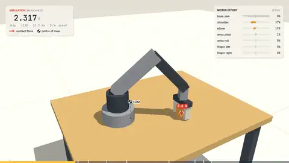

<p align="center"></p>

# physics-studio

[](https://github.com/VinVirtual/physics-studio/actions/workflows/test.yml) [](LICENSE)

A robot plus a plain-language task becomes a narrated physics simulation clip, made on your own machine.

You give it a robot (**URDF** or **MJCF**) and a short **scene recipe** (a table, some objects, and a task: drop, push, pick-and-place, pendulum or cart-pole). physics-studio builds a MuJoCo scene, runs it with a fixed timestep, draws what the physics did on top of the picture (contact-force arrows, centre of mass, motor effort, a time and step counter), writes the narration from the run's own log so it only says what happened, voices it with a local text-to-speech model, and encodes an MP4 with captions.

It is packaged as a [Claude Code](https://claude.com/claude-code) skill (`SKILL.md` tells the assistant how to turn "pick up the cube and put it on the left" into a recipe) and also works by hand from the command line. No GPU, no account, nothing sent anywhere.

## Examples

All four were made by running this repository on a 16-core desktop CPU with no GPU (about 45 to 60 seconds each). Each folder has the recipe, and `out/` has the MP4, poster, captions (VTT), the generated MJCF scene, the run log and the review sheet.

| Example | What happens (from its log) | Video |
|---|---|---|
| [`pick-cube`](examples/pick-cube) | Tern, a five-joint arm written for this repo, grips a 4 cm cube at 2.7 s with up to 16 N of finger force, lifts it 8.1 cm and sets it down 0.2 cm from the target. Task passed. | [landscape](examples/pick-cube/out/pick-cube.mp4), [vertical](examples/pick-cube/out/pick-cube-vertical.mp4), 17.8 s at 0.5x |
| [`cartpole`](examples/cartpole) | An LQR controller holds a 0.7 m pole up from 10 degrees off vertical, takes a 1.2 N·s shove at 3.5 s and settles within 1 degree by 4.55 s. | [MP4](examples/cartpole/out/cartpole.mp4), 19.8 s at 0.5x |
| [`pendulum`](examples/pendulum) | A 0.6 m pendulum released from 40 degrees. Measured period 1.603 s against 1.554 s from the small-angle formula (the difference is the expected large-swing effect); total energy changed by 0.02% over 6 s. | [MP4](examples/pendulum/out/pendulum.mp4), 17.6 s at 0.5x |
| [`drop-blocks`](examples/drop-blocks) | A cube, a ball and a can fall onto a table; first impact at 0.23 s at 2.2 m/s; all three come to rest. | [MP4](examples/drop-blocks/out/drop-blocks.mp4), 15.5 s at 0.25x |

## How it works

1. **Recipe**: a JSON file is checked field by field (types, ranges, unknown keys, sizes, paths). Every problem is listed at once.
2. **Scene**: the robot file is read safely (see below), URDF is converted by MuJoCo's own importer, and a single MJCF scene is written: a lit studio floor, a table, the objects, the robot with one motor per moving joint (its limit taken from the robot file's effort limit), a fixed camera, or a built-in pendulum or cart-pole. Saved as `out/<name>.scene.xml`; it loads in MuJoCo by itself.
3. **Run**: MuJoCo steps the scene at a fixed timestep (default 2 ms) on one CPU thread. Arm tasks are planned with damped least-squares inverse kinematics before the run, then followed by a PD controller with gravity and Coriolis compensation, so the torques you see are what the motors apply. The cart-pole uses LQR computed from MuJoCo's own linearisation. Start positions can be jittered from the seed; the same recipe and seed give the same log, byte for byte (the build runs the simulation twice and stops if they differ).
4. **Log**: `out/<name>.log.json` records events (reach, grasp, lift-off, let go, impact, rest...), every pair of bodies that touched with its peak normal force (all contact points of the pair added up), each motor's peak effort and how often it hit its limit, solver warnings, IK waypoints that could not be reached, and the task result with its reason.
5. **Script**: the automatic narration is written from the log and only states what happened (a set-down is only mentioned after a real grasp and release, a push only after real contact, the pendulum period only after two full swings). Custom lines are your own words: their numbers must come from the log through placeholders such as `{task.final_error_cm}` (a digit typed into a custom line is refused), unknown placeholders are errors, and a line tied to an event that did not happen is left out rather than spoken. The wording itself is not checked, so keep custom lines factual.
6. **Voice and timing**: Kokoro speaks each line locally, phrase by phrase, with word timings. Each line starts at the moment it describes. With `"speed": "auto"` playback slows (down to 0.25x) until no line starts more than 1.5 s late. A video is never longer than 120 s.
7. **Frames**: MuJoCo's offscreen renderer (EGL or OSMesa, CPU is fine) replays the recorded states; overlays are drawn with Pillow at 2x and scaled down. Forces, centre of mass and motor values come from the run itself, not the replay.
8. **Encode**: ffmpeg writes H.264 + AAC with fast start, plus a poster JPEG, the VTT captions and a contact sheet for review.

## What the overlays mean

- **Red arrows**: contact forces, drawn on the object (or the moving body) at the force-weighted mean contact point of each touching pair. Length is `force_scale` metres per newton (default 0.04), capped at 12 cm; a `+` after the label means the arrow was capped. The two biggest are labelled in newtons. On the cart-pole, the arrow is the applied shove.
- **Chequered dot**: centre of mass of the robot (with a dashed plumb line to the surface below), of each object, or of the pendulum / cart-pole system.
- **Motor effort**: each motor's force or torque as a share of its limit; teal is positive, amber negative. 100% in red means the motor is at its limit.
- **Counter**: simulation time, step number, timestep and playback speed. The strip at the bottom is the timeline with a tick per event.
- **Result card**: pass or fail with the reason from the log, after the run ends.

## Limits

Read these before showing a clip to anyone.

- **It is a simulation, not evidence about a real robot.** MuJoCo uses soft contacts; results depend on the timestep, masses, frictions, contact softness and motor limits in the files. The video always says "SIMULATION".
- **Peak contact forces are single-step values.** An impact lasting a few milliseconds can show hundreds of newtons (the drop example peaks at 401.9 N for a 0.2 kg cube). They depend on the timestep and contact stiffness; quote them as "in this simulation".
- **Scripted motion**: arms follow a fixed plan computed before the run (IK waypoints, then minimum-jerk moves). Nothing re-plans if the object slips; the log reports the failure instead. Grasps assume a top-down gripper with fingers that open along one axis.
- **Robot files**: URDF and MJCF only (expand xacro first; SDF is not read). The robot's own actuators are replaced by one motor per controlled joint; sensors and keyframes are dropped; equality constraints, tendons and contact exclusions are kept. MuJoCo's URDF importer uses collision geometry only.
- Pendulum and cart-pole bodies are built in. The double pendulum has no measured period (it is not periodic).
- Word timings inside a phrase are estimated from syllables, so a highlighted word can be a fraction of a second off.
- A grasp is detected when the object touches two different gripper joints' bodies (pads on their child bodies count), or, for a one-joint gripper, the moving jaw and any other part of the robot.
- The bundled fonts cover Latin text; titles or captions in other scripts may show as empty boxes.
- The voice is Kokoro with its fixed voices; it does not clone voices.
- Determinism is checked on one machine. Other CPUs, operating systems or MuJoCo versions can give slightly different numbers.
- **Tested on Linux only** (Ubuntu 22.04, Python 3.12, MuJoCo 4.0.1, Mesa EGL on the CPU).

## What a robot file can reach

A robot file from someone else is untrusted input:

- It is parsed by Python's XML parser with DOCTYPE and ENTITY declarations refused, and never handed to MuJoCo by path, so MuJoCo cannot open files on its own. The cleaned scene is passed as a string with meshes as bytes.
- Meshes (`.stl`, `.obj`, `.msh`), textures and height fields (`.png`) are read only from inside the recipe's folder (so the usual `urdf/` + `meshes/` layout works) after following symbolic links, with size and count caps, and renamed to flat names. Absolute paths, `file://`, URLs and `..` are refused.
- Only a fixed list of MJCF elements may reach MuJoCo. `<include>`, `<plugin>`, `<extension>`, `<model>`, `<skin>`, `<instance>`, `<flex>`, `<flexcomp>`, `<replicate>`, `<composite>` and `<attach>` are refused, as is any other element or attribute that names a file (cube-map faces included). Texture and height-field sizes, element counts (20,000) and bodies (400) are capped.
- Robot files must be UTF-8. MuJoCo stops a diverging state and carries on; physics-studio treats its bad-state warnings as an unstable run, stops, and says so.
- Recipes are size-capped (256 KB), strict JSON (no NaN or Infinity, no duplicate keys, no numbers too large for a float), and capped in steps (60,000), objects (12), narration (16 lines) and video length (120 s).
- Resource budgets are totals over the whole robot, so many small parts cannot add up: PNG sizes are read from the file header before anything decodes them (at most 4096x4096 each, 32 million pixels in all), mesh faces are counted from the file headers for every use of a mesh (1.5 million in all), generated textures (32 million pixels) and height fields (2 million cells) are budgeted, and at most 100 meshes, 30 textures and 4 height fields are allowed. Nesting deeper than 64 levels is refused.
- Outputs are never written through symbolic links: an output folder or file that is a link is refused, and every file (including the MP4 from ffmpeg) is written under a temporary name and renamed into place. The voice step and ffmpeg run with time limits.

## Requirements

| Needed | Why | Licence |
|---|---|---|
| Python 3.12 (the version tested and used in CI) | everything except the voice | PSF-2.0 |
| [mujoco](https://pypi.org/project/mujoco/) 4.x | physics and rendering | Apache-2.0 |
| numpy, pillow | maths, overlays | BSD-3-Clause and others; MIT-CMU |
| Mesa EGL or OSMesa | offscreen OpenGL on the CPU | MIT |
| ffmpeg with libx264 and AAC | encoding; the `imageio-ffmpeg` package (BSD-2-Clause wrapper) ships a GPL build | LGPL or GPL depending on the build |
| [kokoro-onnx](https://github.com/thewh1teagle/kokoro-onnx) in its own Python (3.10 to 3.13), with `kokoro-v1.0.onnx` and `voices-v1.0.bin` (about 340 MB) | the voice (optional: `--no-voice`) | MIT; the Kokoro-82M model is tagged Apache-2.0 on its model card; phonemizer and espeak-ng are GPL-3.0-or-later |
| pytest | the tests | MIT |

Licences were read from each package's metadata on 22 November 2026; check again before you rely on them. None of these is included in this repository.

### Included

- `assets/fonts/Geist.ttf` (Copyright 2024 The Geist Project Authors) and `assets/fonts/JetBrainsMono.ttf` (Copyright 2020 The JetBrains Mono Project Authors): unchanged copies, **SIL Open Font License 1.1**, notice and licence in `assets/fonts/OFL.txt`.
- `templates/robots/tern.urdf`: Tern, the example arm, written for this repository from boxes and cylinders. Not a real product. MIT, like the rest of the code.
- Everything else (code, recipes, example outputs) is MIT. The example videos use the Kokoro `af_heart` voice.

## Install

```bash
git clone https://github.com/VinVirtual/physics-studio ~/.claude/skills/physics-studio
cd ~/.claude/skills/physics-studio

# 1. physics: a venv inside this folder
python3.12 -m venv .venv && .venv/bin/pip install mujoco numpy pillow imageio-ffmpeg pytest   # or: uv venv .venv --python 3.12
# offscreen OpenGL, if missing (Debian/Ubuntu): sudo apt install libegl1 libgl1-mesa-dri

# 2. the voice (optional): kokoro-onnx in its own venv, and the model files
python3 -m venv ~/kokoro/.venv && ~/kokoro/.venv/bin/pip install kokoro-onnx soundfile numpy
cd ~/kokoro
curl -LO https://github.com/thewh1teagle/kokoro-onnx/releases/download/model-files-v1.0/kokoro-v1.0.onnx
curl -LO https://github.com/thewh1teagle/kokoro-onnx/releases/download/model-files-v1.0/voices-v1.0.bin
cd -

# 3. check
./check_env.sh
```

| Variable | Default |
|---|---|
| `PHYSICS_STUDIO_PYTHON` | `.venv/bin/python` in this folder, else `python3` |
| `MUJOCO_GL` | `egl` (or `osmesa`) |
| `PHYSICS_STUDIO_GL` | for `check` only: test this one backend instead of trying `egl`, then `osmesa` |
| `PS_REQUIRE_GL` | `1` makes the rendering tests fail instead of skip when OpenGL is missing (set in CI) |
| `KOKORO_HOME` | `~/kokoro` (model files, and the voice venv) |
| `PHYSICS_STUDIO_VOICE_PYTHON` | `$KOKORO_HOME/.venv/bin/python`, else `python3` |
| `FF` | `ffmpeg` on the PATH, else the one inside `imageio-ffmpeg` |

## Quick start

```bash
./physics-studio new my-clip --task pick_place     # recipe.json and robot/tern.urdf
./physics-studio sim my-clip/recipe.json           # run only: PASS or FAIL and out/pick-cube.log.json
./physics-studio sheet my-clip/recipe.json         # look at out/pick-cube-sheet.png
./physics-studio build my-clip/recipe.json         # out/pick-cube.mp4, .jpg, .vtt, .scene.xml, .log.json
./physics-studio build my-clip/recipe.json --format vertical
```

## Commands

```
physics-studio check [--no-voice]        MuJoCo, offscreen rendering, ffmpeg, Kokoro
physics-studio new <dir> [--task T]      a recipe to edit (pick_place, push, drop, pendulum, cartpole)
physics-studio validate <recipe.json>    check the recipe and the robot file, compile the scene
physics-studio inspect <robot file>      joints (type, range, effort) and bodies   [--json]
physics-studio scene <recipe.json>       write the MJCF scene only
physics-studio sim <recipe.json>         run, write the scene and the log
physics-studio sheet <recipe.json>       run, voice, and a contact sheet of overlaid frames
physics-studio build <recipe.json>       everything   [--format landscape|vertical|square] [--out DIR] [--no-voice]
physics-studio test                      the test suite
```

## The recipe

```json
{
  "name": "pick-cube",                    "title": "Tern picks up a cube",
  "task": "pick_place",                   "seed": 7,  "timestep": 0.002,  "duration": 8.0,
  "robot": {
    "file": "robot/tern.urdf",            "base": [0, 0, 0],  "yaw_deg": 0,
    "end_effector": {"body": "palm", "offset": [0, 0, 0.075]},
    "gripper": {"joints": ["finger_left", "finger_right"], "open": [0.04, 0.04], "closed": [0.012, 0.012], "force": 8},
    "home": {"shoulder": 0.3, "elbow": 1.2, "wrist_pitch": 1.2}
  },
  "table": {"size": [0.45, 0.35], "height": 0.4, "pos": [0.2, 0.0]},
  "objects": [{"id": "cube", "shape": "box", "size": [0.02, 0.02, 0.02], "mass": 0.08,
               "pos": [0.27, -0.13, 0.0], "color": "ochre", "jitter": 0.004}],
  "goal": {"object": "cube", "place": [0.22, 0.15], "tolerance": 0.025, "lift": 0.08},
  "video": {"format": "landscape", "fps": 30, "speed": "auto"}
}
```

| Field | Meaning |
|---|---|
| `name` | letters, digits, `-` and `_`; names the output files |
| `task` | `pick_place`, `push`, `drop`, `pendulum` or `cartpole` |
| `seed`, `timestep`, `duration` | seed for start jitter; seconds per step (0.0005 to 0.01); seconds simulated (at most 60, and 60,000 steps) |
| `robot.file` | URDF or MJCF, relative to the recipe; meshes anywhere inside the recipe's folder |
| `robot.base`, `robot.yaw_deg` | base position (x, y, height above the surface below) and heading |
| `robot.end_effector` | the body that carries the grasp point and its offset in that body's frame |
| `robot.gripper` | finger joints with their open and closed values, and the squeeze force cap (N) |
| `robot.arm_joints` | joints the IK may move (default: every hinge and slide joint that is not a finger) |
| `robot.home`, `kp`, `kd`, `armature`, `color` | start pose (radians or metres), controller gains (1/s², 1/s), joint armature, colour |
| `table` | `size` (half-extents x, y), `height`, `pos`, `color`; `false` for none |
| `objects[]` | `id`, `shape` (`box` half-sizes x y z, `sphere` radius, `cylinder` radius and half-height), `mass` (kg), `pos` (x, y, height of its bottom above the surface below), `yaw_deg`, `color` (`ochre`, `cobalt`, `teal`, `plum`, `sage`, `graphite`, `bone`, `brick` or `#rrggbb`), `friction`, `jitter` (m) |
| `goal` | pick_place: `object`, `place` [x, y], `tolerance`, `lift`. push: `object`, `direction_deg`, `distance`, `tolerance`. drop: `rest_speed` |
| `pendulum` | `links` (1 or 2), `length`, `mass`, `angle_deg`, `damping`, `pivot_height` |
| `cartpole` | `pole_length`, `pole_mass`, `cart_mass`, `angle_deg`, `controller` (`lqr` or `none`), `force_limit`, `push` {`at`, `impulse` in N·s} |
| `camera` | `lookat`, `distance`, `azimuth`, `elevation`, `fovy`, and the same per format under `landscape`, `vertical`, `square` |
| `overlays` | `forces`, `com`, `torques`, `hud`, `captions` (true or false), `force_scale` (m/N), `min_force` (N) |
| `video` | `format`, `fps` (24, 25, 30, 50, 60), `speed` (`auto` or 0.1 to 4), `hold_end` (s) |
| `voice` | `on`, `voice` (a Kokoro voice such as `af_heart`), `speed`, `lang` (`en-us`, `en-gb`) |
| `narration` | `"auto"`, or a list of `{"at": "start" / "end" / "event:<type>" / seconds, "say": "text with {placeholders}"}`; digits are only allowed through placeholders |

Placeholders are any value in the log, flattened with dots (`{task.final_error_cm}`, `{contacts.max_normal_N}`, `{objects.cube.max_height_m}`), plus `{events.<type>}` for the first time of an event. `{x:1}` rounds to one decimal.

## Outputs

```
out/<name>.mp4           H.264 + AAC, 1280x720, 720x1280 or 960x960, with burned-in captions
out/<name>.jpg           poster frame
out/<name>.vtt           WebVTT captions
out/<name>.scene.xml     the generated MJCF (+ <name>.scene.assets/ with the robot's meshes)
out/<name>.log.json      the run log
out/<name>.script.json   the narration with its timings, lines left out and why, and the playback speed
out/<name>-sheet.png     overlaid frames at the key moments, for review
```

A build with `--format` other than the recipe's own adds the format to the names (`<name>-vertical.mp4`, `.vtt`, `.jpg`, `.scene.xml`, `.script.json`, `-sheet.png`); the log is the same run and is shared.

## Tests

```bash
./physics-studio test
```

195 tests: recipe validation with bad and hostile input, robot-file safety (paths, symbolic links, XML declarations, refused MJCF elements, size caps), MJCF generation (motors, positions, camera, URDF and MJCF robots, standalone scene files), determinism (same seed gives the same log; recording frames does not change the run; the command line twice gives identical files), physics checks against theory (pendulum period with the large-swing correction, energy conservation, free-fall impact speed and time, support force equal to weight), task outcomes (pick, push, LQR recovery, uncontrolled fall, an unreachable target failing honestly), overlay maths (projection against MuJoCo's own render, arrows, bars, text wrapping), timing and captions, narration from logs, the audio mix and an end-to-end build. Tests that need offscreen OpenGL skip, and say so (`-rs`), when it is missing, unless `PS_REQUIRE_GL=1`; the CI workflow sets it. The suite also covers the review fixes: whole-robot budgets, isolated probes, links at output paths, narration gating, card layout, video caps and VTT escaping.

## Licence

MIT, see [LICENSE](LICENSE). The fonts are under the SIL Open Font License 1.1 (see above).
